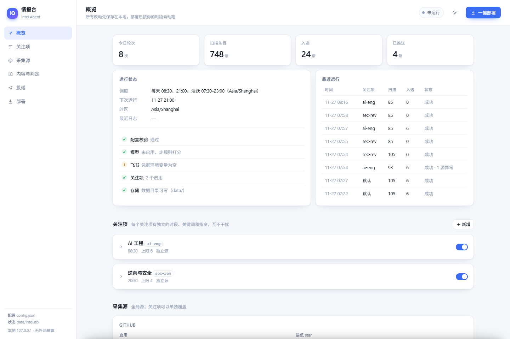
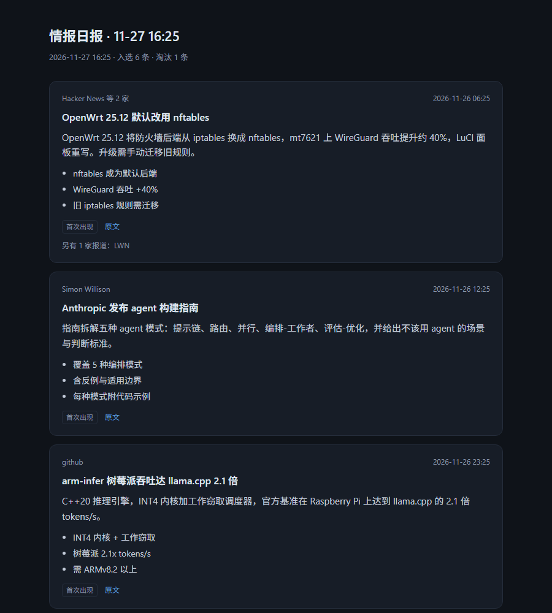

# intel-agent

> AIGC 作业 · 热点新闻定期推送（仓库名 `dailyinformation_push`）

**一条会自己闭麦的资讯流水线。** 按关注项分区采集、四道闸门裁决、静默优先，只把「今天真的变了」
的那几条推给你，剩下的留到晚间简报。

纯 Python 标准库实现，**零第三方依赖**，Python 3.10+。

[](https://www.python.org/)


[](LICENSE)



## 目录

- [特性](#特性)
- [环境要求](#环境要求)
- [快速开始](#快速开始)
- [控制台](#控制台)
- [命令行](#命令行)
- [配置](#配置)
- [推送通道](#推送通道)
- [工作原理](#工作原理)
- [项目结构](#项目结构)
- [测试](#测试)
- [已知限制](#已知限制)
- [数据与合规](#数据与合规)
- [文档](#文档)
- [贡献](#贡献)
- [许可证](#许可证)

## 特性

- **关注项分区**：一路订阅 = 一套关键词、附加要求、频率、语言。水位线按关注项隔离——A 路把某个源
  推进到 10:00，不会让 B 路漏掉 09:00 的条目；同一个 URL 跨关注项只推一次。
- **推不推由代码决定**：模型只做四件事（规划检索词、丢掉明显无关、打分写摘要、挑一条写大纲），
  真正的裁决是四道闸门 + 配额 + 静默阈值。模型换了、挂了，行为不会漂移。
- **静默优先**：本轮最高置信低于阈值就一条都不发，只入库，攒到晚间简报里统一交代。
- **只说事实**：标题、来源与时间、一句摘要、2-3 条可核验要点。没有「为什么推」、没有 emoji、
  没有第二人称劝告。
- **三个出口**：飞书（webhook / 企业自建应用）、钉钉（群机器人，加签）、Telegram。
  消息里不带按钮，反馈统一收到控制台。
- **源可控**：自定义 RSS / 页面监控 / GitHub / HN；一个源都没配时，才由 AI 在白名单目录里挑，
  并且必须真抓成功才算数。
- **反馈会改权重**：控制台按关注项记账，「没用」要选原因（跑题 / 重复 / 太浅 / 标题党 / 不可信 / 太旧），
  不同原因扣不同倍数。
- **可观测**：一轮一份 JSONL 轨迹、SQLite 状态库、`stats` / `trace` 两条命令把「为什么今天只有 2 条」
  摊开给你看。

## 环境要求

| 项 | 要求 |
|---|---|
| Python | 3.10 及以上（用到 `X \| None` 与 `dataclass`） |
| 第三方包 | 无。全部标准库，`pip install` 一步可以跳过 |
| 系统 | Windows / Linux / macOS |
| 网络 | 直连即可；模型走 OpenAI 兼容端点，可选 |

模型不是必需项：`llm.enabled=false` 时用规则打分与原文前两句摘要，照样能跑完整链路。

## 快速开始

```bash
git clone <this-repo> && cd intel-agent
python main.py init                       # 生成 config.json（已存在则跳过）

# 1. 离线自检：16 条夹具，不联网、不调用模型
python main.py run --offline --dry-run --no-llm

# 2. 真实抓取：GitHub + HN + 8 个中英文 RSS，只出报告不推送
python main.py run --dry-run --no-llm
```

产物在 `out/`（`digest-*.md` 与 `digest-*.html`），一轮一份轨迹在 `traces/`。
确认报告没问题，再去掉 `--dry-run` 就会真的推送（需要先配好通道，见[推送通道](#推送通道)）。

配了多个关注项时，`run` 默认跑全部启用项；只想跑一路用 `--topic`：

```bash
python main.py topics list                      # 有哪几路、各自的频率
python main.py run --topic sec-rev --dry-run    # 只跑「逆向与安全」这一路
python main.py brief --day today                # 生成 / 补发晚间简报
```

## 控制台

```bash
python webui/server.py           # http://127.0.0.1:8765
```

七个区块对应一份配置：概览、关注项、采集源、内容与判定、投递、部署、反馈。

- **关注项**：卡片式编辑时段、关键词、指令和独立采集源，改完「保存这一项」。
- **采集源**：GitHub topics / 语言 / star 门槛，HN 检索词，RSS 每行一条 `名称 | URL | zh/en`，
  以及「AI 自动选源」。
- **内容与判定**：输出语言、四道闸门下限、token 预算；两段系统提示词可展开只读。
- **投递**：飞书 webhook / app 模式、钉钉群机器人、Telegram，静默阈值、简报时间、待办阈值。
- **部署**：「一键部署」不是生成一句命令，而是真的在后台拉起 `main.py schedule`，pid 落在
  `data/deploy.json`，关掉页面也继续跑；另有「干跑一次」「停止」「查看日志」。
  「生成服务文件」产出 Windows 计划任务 / systemd / launchd 三份文件（`data/deploy/`），
  安装命令由你确认后执行。
- **反馈**：选关注项 → 每条三颗按钮（有用 / 没用 / 收藏），点「没用」就地展开六个原因。

服务只监听 `127.0.0.1` 并校验 `Host` / `Origin`：配置里有 chat_id 和密钥变量名，不能被局域网页面
或 DNS rebinding 读走。写配置前先跑一遍 `validate`，不通过不落盘。

## 命令行

| 命令 | 作用 |
|---|---|
| `python main.py init` | 生成默认配置 |
| `python main.py run` | 跑一轮（多关注项时默认全部启用项） |
| `python main.py schedule` | 常驻定时：每个关注项按自己的频率 + 晚间简报 |
| `python main.py brief` | 生成 / 补发晚间简报 |
| `python main.py topics` | 关注项增删改查、历史 |
| `python main.py config` | 查看 / 修改用户设置 |
| `python main.py sources` | 源列表、单 feed 体检、自动选源 |
| `python main.py feedback` | 记录反馈；不带 `--id` 时列出最近条目 |
| `python main.py stats` | 权重、原因分布、今日 token、最近运行 |
| `python main.py trace` | 最近一次各阶段耗时与错误 |
| `python main.py feishu` | 飞书连通性调试（`test` / `chats`） |
| `python main.py dingtalk` | 钉钉连通性调试（`test`） |

每个子命令都支持 `-h`。所有命令默认读 `./config.json`，可用 `--config` 指向别处。

## 配置

`python main.py init` 生成 `config.json`；仓库里的 [`config.example.json`](config.example.json)
是同一份默认值，只作参考。真实配置与备份不进版本库（见 `.gitignore`）。

```bash
python main.py config show

python main.py config set \
  --focus "LLM agent,C++ 并发,逆向工程" \
  --avoid "加密货币,招聘广告" \
  --language zh \
  --instructions "偏工程细节，写清版本号和性能数字" \
  --tokens-run 60000 --tokens-day 200000 --on-exceed degrade \
  --mode times --times 08:30,21:00 \
  --weekdays 1,2,3,4,5 --active-hours 07:30-23:00 \
  --channels feishu --max-items 6
```

写盘只有一条路径：**校验 → 备份 → 原子写**。校验不过不落盘，旧配置保留最近 10 份，
统一放在 `data/backups/`。

配置分九块：`profile`（关注范围与输出语言）、`budget`（token 上限与超限行为）、`topics`（关注项）、
`ai`（采集侧三个开关）、`sources`（采集源）、`filter`（闸门与静默）、`output`（内容形态）、
`channels`（通道凭据的环境变量名）、`schedule`（时段与频率）。

逐键说明、关注项写法、人格模板怎么落到字段上：见 [docs/配置与关注项.md](docs/配置与关注项.md)。

**接模型（可选）**：

```bash
export LLM_API_KEY='sk-...'
python main.py config set --ai on
# 再改 config.json：llm.base_url / llm.model 指向你的 OpenAI 兼容端点
```

模型不可用、返回垃圾、预算不足时，三个节点都会降级：plan 回落配置查询、triage 全保留、
judge 走规则。**不会因为模型挂了就没有简报。**

## 推送通道

| 通道 | 形态 | 说明 |
|---|---|---|
| 飞书 | 自定义机器人 webhook | 最快，只需一个地址 + 可选签名密钥 |
| 飞书 | 企业自建应用 | 可列群、可主动发、可写待办，需要 app_id / app_secret |
| 钉钉 | 群机器人 webhook | 加签后一轮合并成一条 markdown |
| Telegram | Bot API | 一条事件一条消息 |

最小一套（飞书 webhook）：

```bash
export FEISHU_WEBHOOK='https://open.feishu.cn/open-apis/bot/v2/hook/xxx'
export FEISHU_SECRET='...'                     # 开了签名校验才需要
python main.py config set --channels feishu
python main.py feishu test                     # 先验通路，再谈内容
```

密钥只存环境变量，`config.json` 里只记变量名（如 `webhook_env: "FEISHU_WEBHOOK"`），
错误信息里的 token 会打码后才进日志。

推送不带图：正文是文字 + 原文链接。原因见
[docs/推送通道与反馈.md](docs/推送通道与反馈.md#5-不带图已定)。通道细节（加签算法、分段策略、
限流、反馈原因分档）都在同一份文档里。

## 工作原理

```
plan(AI) → fetch → 归一化 → 水位线 → 去重 → 初筛(AI) → 事件簇 → 粗排
         → 四闸(AI) → 配额 → [选题] → [飞书待办] → 渲染 → 飞书/钉钉/Telegram
                                              ↘ 静默（不打扰）→ 晚间简报
```

三条设计原则：

1. **确定性优先**：采集、去重、聚类、配额、投递全是代码；模型只在三个节点提供判断素材。
2. **闸门决定推不推**：相关性、信息量、可核验性、actionability 四道闸门各有下限，
   再由配额截断、静默兜底。分数与置信度不写进读者看到的那段话。
3. **降级不空手**：模型超时、超预算、返回非法结构，都退回规则路径，而不是整轮失败。

输出长这样（`out/digest-*.html`）：



## 项目结构

```
intel-agent/
├── main.py                 # CLI 入口：12 个子命令
├── config.example.json     # 默认配置模板（提交）；运行时生成 config.json
├── intel/                  # 核心包：一条九段链路
│   ├── pipeline.py         #   主编排：run_once
│   ├── sources/            #   采集：github / hn / rss / page
│   ├── aiplan.py           #   采集侧 AI：检索规划
│   ├── judge.py            #   四闸判定 + confidence
│   ├── render.py           #   渲染：markdown / 飞书卡片 / 钉钉 / Telegram / HTML
│   ├── push.py             #   投递：分流 + 幂等 + 失败隔离
│   ├── store.py            #   SQLite 状态库
│   ├── topics.py           #   关注项
│   └── …                   #   normalize / dedupe / cluster / coarse / quota / watermark …
├── webui/
│   ├── server.py           # 本地控制台（http.server，仅 127.0.0.1）
│   └── ui.html             # 单页前端，无构建链
├── tests/                  # 测试与评测
│   ├── run_eval.py         #   25 条规则评测
│   ├── test_*.py           #   12 套测试
│   └── fixtures/           #   离线夹具：16 条通用 / 43 条跨领域
├── docs/                   # 配置、数据源、通道与反馈、截图
├── data/                   # 运行时：intel.db、选源缓存、配置备份、生成的服务文件（不提交）
├── out/                    # 运行时：日报 md/html、简报（不提交）
└── traces/                 # 运行时：一轮一份 JSONL 轨迹（不提交）
```

## 测试

```bash
python tests/run_eval.py                # 25 条规则评测（通过线 90%）
python tests/test_e2e.py                # 端到端 + 幂等
python tests/test_llm_path.py           # LLM 解析 / 降级 / 注入（本地 mock）
python tests/test_new_features.py       # plan 校验、预算、调度、语言配比、飞书签名
python tests/test_delivery_features.py  # 关注项分区、待办幂等、选题防幻觉、静默与简报
python tests/test_content_format.py     # 只传事实：headline/points 解析、五通道无推荐理由
python tests/test_dingtalk.py           # 钉钉加签、payload、errcode、分段、心跳（7 组）
python tests/test_topic_matrix.py       # 关注项矩阵：不同主题/提示词互不串味（10 组）
python tests/test_mixed_domains.py      # 跨领域：金融/医疗/体育/游戏/教育零交叉（9 组）
python tests/test_personas.py           # 十二人格：各自阈值与召回（8 组）
python tests/test_autosource.py         # 兜底选源：触发条件、白名单、真抓校验、缓存（9 组）
python tests/test_feedback.py           # 反馈按主题记账 + 原因分档（10 组）
python tests/make_demo.py               # 生成一份离线样例日报，肉眼核对版式
```

全部用 `unittest`-free 的断言脚本写，**不需要任何测试框架**，`python tests/xxx.py` 直接跑，
失败即非零退出。2026-11-27 实测：12 套全绿 + `run_eval` 25/25。

## 已知限制

- **规则模式的摘要不是摘要**：只是原文前两句，中文源还会带「查看全文」尾巴；开 LLM 才有
  45–80 字改写 + 2–3 条要点。
- **25 条评测验证的是「行为符合设计意图」**，不是真实世界准确率；阈值需要用真实数据校准。
- **关键词是字面子串匹配**：中文词命中不了英文标题，中英混源必须写双语关键词。
- **关注项关键词收得越窄，越可能整轮 0 条**。这是语义正确的「今天确实没有」，不是故障；
  要放宽就调该关注项的 `filter.gates.relevance.floor`。
- **控制台只暴露高频字段**：源权重、weekdays、RSS 的 weight/limit 仍改 `config.json`。
- **`interval` 模式没有分布式锁**：多实例会重复推送（靠 30 天幂等兜底）。
- **飞书待办只在 app 模式可用**，且需要租户开 `task:task:write` 后才能验通。
- **自动选源的白名单是静态表**：新站点要先加进 `DOMAIN_TIERS`；目录里的 feed 也会失效
  （实测 arXiv 本机不可达、36kr feed 已坏），失效项只记录、不自动替换。
- **推送不带图**：采集层没有图片字段，飞书 webhook 也发不了图（`img_key` 需应用态上传）。
- **没有 CI**：测试靠手动跑，仓库里也没有发布产物。

## 数据与合规

- **只存标题、链接、短摘要**，不全文转载；摘要为自生成，原文版权归原站点。
- **抓取走官方 API / RSS**，尊重站点条款与限流，不做高频轮询。
- **本地优先**：状态库是 `data/intel.db`，轨迹是本机 JSONL，控制台只监听 `127.0.0.1`，
  没有云端账号、没有遥测。
- **凭据只进环境变量**：`config.json` 只保存变量名，可以安全地分享出去（仍建议不要提交真实配置）。

## 文档

| 文档 | 内容 |
|---|---|
| [docs/配置与关注项.md](docs/配置与关注项.md) | 全部配置键、关注项语义、非科技主题、人格模板映射 |
| [docs/数据源.md](docs/数据源.md) | 自定义源三类写法、三条纪律、自动选源的三层把关 |
| [docs/推送通道与反馈.md](docs/推送通道与反馈.md) | 飞书 / 钉钉 / Telegram、分流与静默、反馈原因分档 |
| [设计方案](../docs/AI推送智能体-设计方案.md) | 九段链路的设计推演、取舍与实测记录（工程外文档） |

## 贡献

欢迎 Issue 与 PR。提之前请先确认几件事：

1. **不引入第三方依赖**。这个项目的部署前提是「有 Python 就能跑」，加一个包就会破坏它。
2. **新能力配一个测试**，放在 `tests/test_*.py`，沿用现有脚本风格（无框架、断言失败即非零退出）。
3. **推不推的逻辑不要交给模型**。要加判断维度，就加闸门或配额，并在 `config.example.json` 里给默认值。
4. 报 bug 时附上 `python main.py stats` 与 `python main.py trace` 的输出（不含密钥），
   比描述「今天没推到」有用得多。

```bash
python tests/run_eval.py && for f in tests/test_*.py; do python "$f" || break; done
```

## 许可证

[MIT](LICENSE) © 2026 skrin
